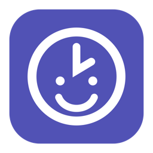
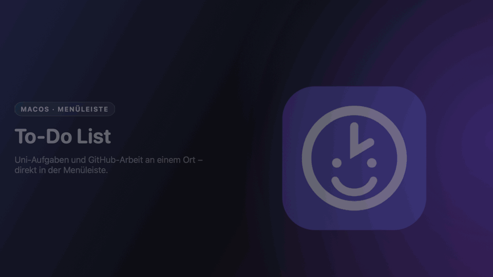
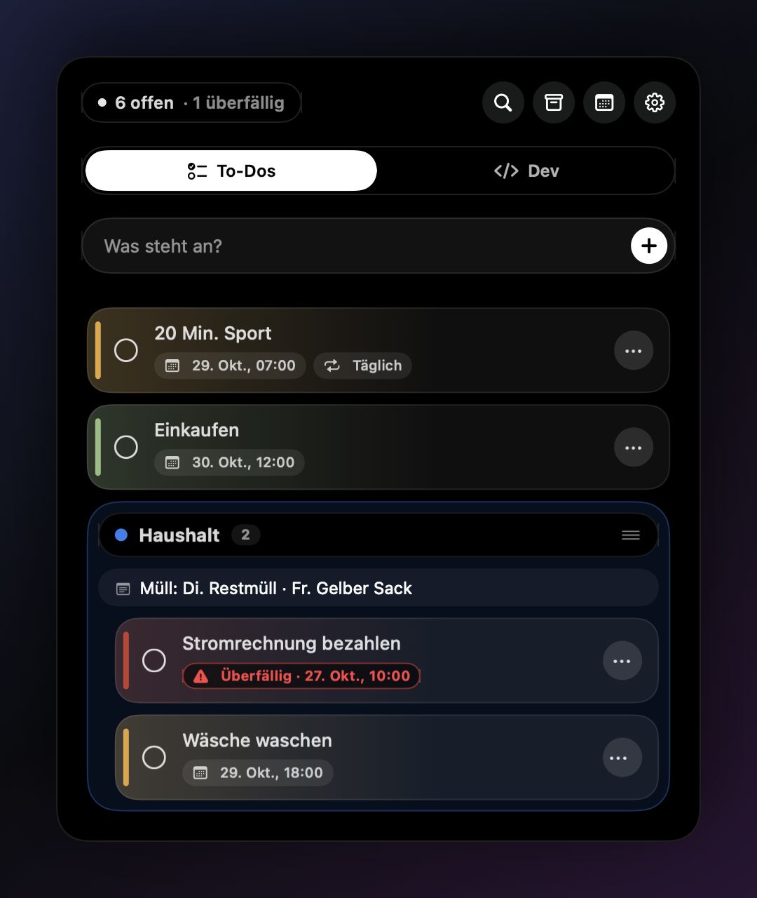
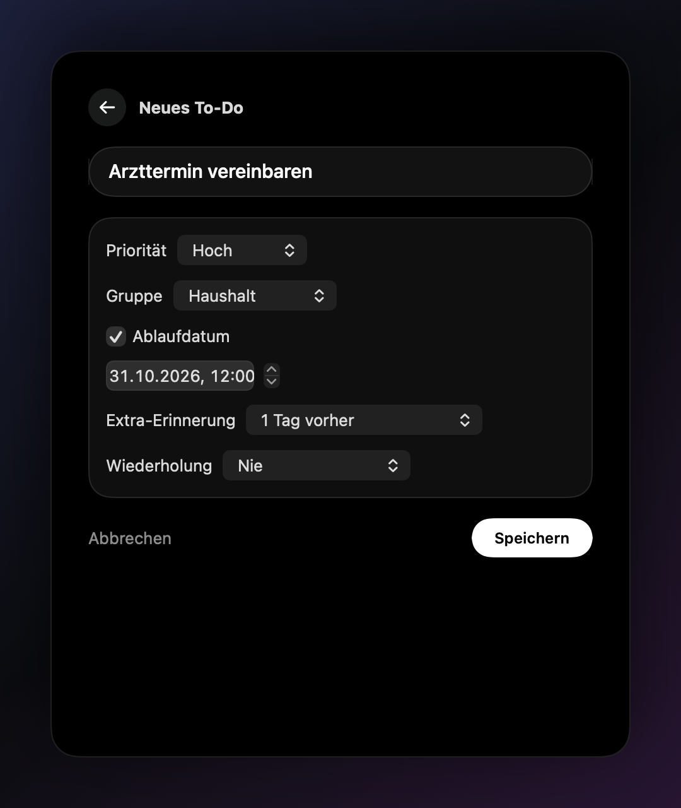
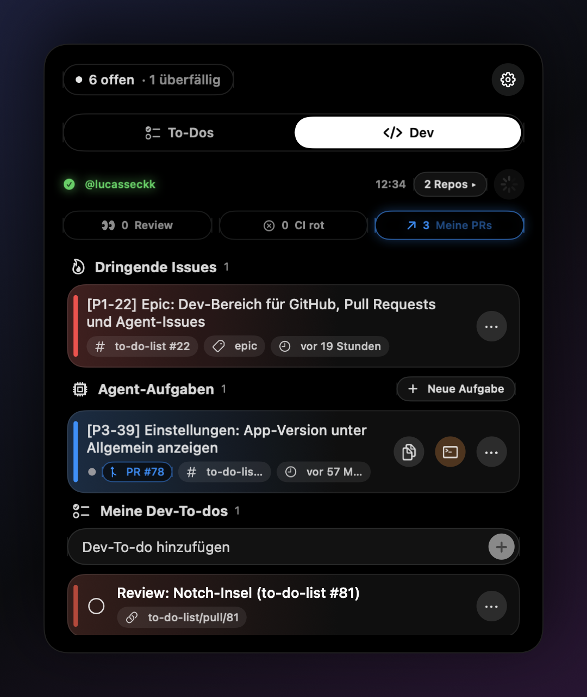
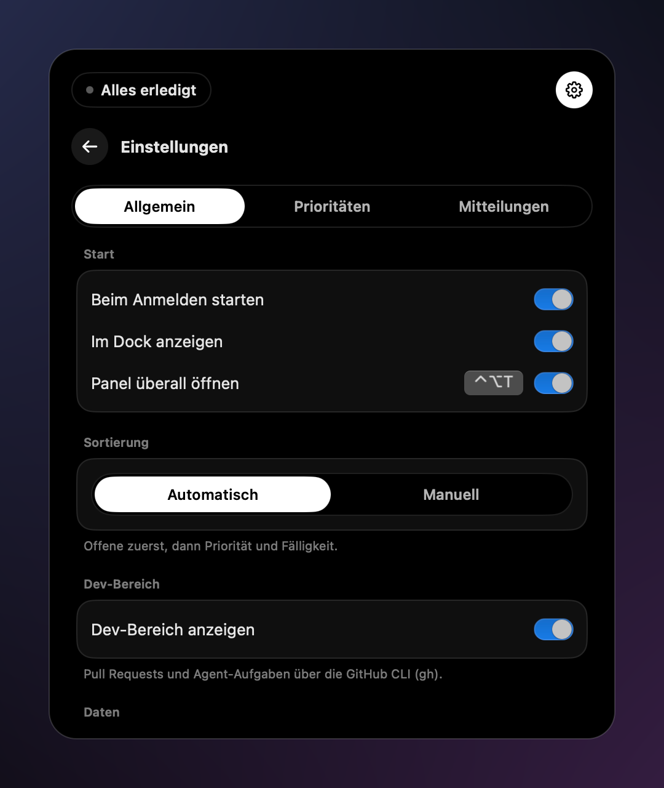
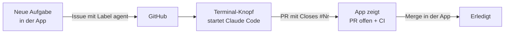

<div align="center">



# Ticky

**Uni-Aufgaben und GitHub-Arbeit an einem Ort – direkt in deiner Menüleiste.**

[](#installation)
[](Package.swift)
[](Sources/KleineListe)
[](Package.swift)
[](#dev-bereich)
[](#agent-aufgaben)
[](#daten-und-datenschutz)



[Features](#features) · [Installation](#installation) · [Dev-Bereich](#dev-bereich) · [Agent-Aufgaben](#agent-aufgaben) · [Tastatur](#tastatur) · [Datenschutz](#daten-und-datenschutz)

</div>

---

**Ticky** ist eine To-do-Liste, wie man sie kennt – Aufgaben, Fälligkeiten, Erinnerungen, Gruppen. Sie soll aber der **eine Ort** sein, an dem neben Übungsblättern und Abgaben auch die **Entwicklungsarbeit** sichtbar ist: offene Pull Requests, rote CI, dringende Issues und Aufgaben, die Coding-Agents wie Claude Code selbst abarbeiten. Die Oberfläche ist an Apples **Dynamic Island** angelehnt: tiefschwarzes Panel, Pillen und Kapseln, leuchtende Akzente, federnde Animationen.

## Features

<table>
<tr>
<td width="50%" valign="top">

<h3>To-Dos, die mitdenken</h3>
Prioritäten (auch eigene, Stufe 1–5), Fälligkeiten, Gruppen mit Farbe und Notiz, Wiederholungen und Erinnerungen. Überfälliges leuchtet rot, Status-Pille oben fasst alles zusammen.
</td>
<td width="50%" valign="top">

<h3>In Sekunden erfasst</h3>
<kbd>⌃</kbd><kbd>⌥</kbd><kbd>T</kbd> öffnet das Panel von überall, <kbd>⌘</kbd><kbd>N</kbd> legt an. Priorität, Gruppe, Ablaufdatum, Extra-Erinnerung und Wiederholung in einer Ansicht.
</td>
</tr>
<tr>
<td width="50%" valign="top">

<h3>GitHub im Blick</h3>
Reviews, rote CI, eigene PRs, dringende Issues und Agent-Aufgaben – live über die GitHub CLI. Mergen mit Zwei-Klick-Bestätigung, ohne dass die App je ein Token sieht.
</td>
<td width="50%" valign="top">

<h3>Einstellbar, nicht überladen</h3>
Autostart beim Anmelden, globales Tastenkürzel, Sortierung, Gruppen, eigene Prioritäten und Farben, Erinnerungen je Priorität sowie Export und Import.
</td>
</tr>
</table>

<details>
<summary><b>Alle To-do-Funktionen</b></summary>

- **Karten:** Prioritätsfarbe als Verlauf mit leichtem Schein, darunter Pillen für Datum, Erinnerung, Wiederholung, Gruppe und „später“ (Snooze).
- **Schnell bearbeiten:** Doppelklick benennt um; das ⋯-Menü ändert Priorität und Gruppe, öffnet Fälligkeit und Wiederholung, archiviert oder löscht.
- **Gruppen:** Farbiger Pillen-Kopf mit Anzahl und mitwachsender Notizzeile. Gruppen am Griff ≡ verschieben, To-dos per Drag-and-drop hinein, zwischen und wieder heraus ziehen.
- **Sortierung:** automatisch (offen vor erledigt, dann Priorität, Fälligkeit, Erstellung) oder manuell.
- **Suche & Ansichten:** Filter-Voreinstellungen (Überfällig, Heute, Priorität, Gruppe …), Fälligkeitsansicht (Überfällig, Heute, Morgen, Diese Woche, Später), Archiv für Erledigtes.
- **Wiederholungen:** täglich, wöchentlich, monatlich oder an eigenen Wochentagen – Abhaken schiebt auf den nächsten Termin.
- **Erinnerungen:** lokale macOS-Mitteilungen mit Aktionen „Erledigt“ und „Später“ (10 Min., 1 Std., morgen 9:00). Vorlaufzeit je Priorität einstellbar. Jede Mitteilung zeigt die Uhr mit passendem Gesicht: fröhlich bei normalen Erinnerungen, gestresst mit Schweißtropfen, wenn etwas bald fällig ist, X-Augen bei Überfälligem.
- **Menüleisten-Uhr:** neutral, solange etwas offen ist – lächelt, sobald alles erledigt ist.
- **Rückgängig (⌘Z)** für Löschen, Erledigen, Verschieben, Archivieren und Gruppenänderungen.
- **Start:** optional beim Anmelden (macOS-Anmeldeobjekte, kein Hilfsprogramm); das Panel öffnet sich dort, wo du es verlassen hast.

</details>

## Installation

Voraussetzungen: **macOS 14** oder neuer, Xcode oder Swift 6 mit macOS-SDK.

```bash
git clone https://github.com/lucasseckk/to-do-list.git
cd to-do-list
zsh check.command          # Regressionstests
zsh build.command --open   # bauen, installieren und starten
```

Die App wird nach `~/Applications/Ticky.app` installiert und erscheint als Uhr in der Menüleiste und im Dock. Danach startest du sie wie jede App: <kbd>⌘</kbd><kbd>Leertaste</kbd> → „Ticky“. Beenden per Rechtsklick aufs Dock-Icon oder unter Einstellungen → Allgemein → Start; dort lässt sich das Dock-Icon auch ausblenden. Die App ist lokal ad-hoc signiert und nicht für die öffentliche Verteilung notarisiert. Vor einem Neubau eine laufende Instanz mit `pkill -x Ticky` beenden.

## Dev-Bereich

Der Dev-Bereich spricht GitHub **ausschließlich über die GitHub CLI** an. Die App speichert keine Tokens, Passwörter oder Kontodaten – die Anmeldung liegt allein bei `gh`.

```bash
brew install gh
gh auth login
```

Fehlt `gh` oder ist es nicht angemeldet, zeigt der Dev-Bereich genau diese Befehle zum Kopieren an. Welche Repositories erscheinen, wählst du direkt im Dev-Bereich: Klick auf **„N Repos ▾“** öffnet die Auswahl. Bei mehreren Repos trennt ein kleiner Trenner mit Repo-Namen PRs, Reviews und Issues.

| Bereich | Was du siehst und tun kannst |
| --- | --- |
| **Zähler-Pillen** | 👀 Review angefordert · ✕ CI rot · ↗ meine PRs – ein Klick springt zum Abschnitt |
| **Dringende Issues** | Titel mit `[P1…]`, Label `dringend`/`P1` oder dir zugewiesen; nach Rang sortiert, Repo-Filter, als Dev-To-do merken oder an einen Agent übergeben |
| **Pull Requests** | CI-Punkt (grün, rot, gelb pulsierend, grau), Autor, Alter, Draft. Mergen nur bei grüner oder fehlender CI, mit Zwei-Klick-Bestätigung |
| **Meine Dev-To-dos** | Lokale Liste nur für Entwicklung; „Als To-do“ auf einer PR-Karte legt ein Review-To-do mit Link an |
| **Aktualisierung** | beim Öffnen, alle 2 Minuten bei offenem Panel und per ↻ |

### Agent-Aufgaben

Aufgaben für Coding-Agents sind **GitHub-Issues mit dem Label `agent`** – so findet ein Agent sie selbst, ganz ohne Zugriff auf die App.



- **Anlegen:** „Neue Aufgabe“ → Repository, Titel, Aufgabe, Akzeptanzkriterien. Die App legt ein strukturiertes Issue an.
- **Claude Code starten:** Der Terminal-Knopf auf der Karte kopiert den fertigen Prompt und öffnet **Terminal mit `claude`** im lokalen Ordner des Repos. Den Ordner wählst du beim ersten Mal (änderbar über ⋯). Der Prompt wird über eine private Datei übergeben, nie als Shell-Befehl – Issue-Text kann nichts ausführen.
- **Oder selbst übergeben:** Prompt kopieren und in Claude Code oder Codex einfügen – oder der Agent sucht selbst mit `gh issue list --label agent`; das Vorgehen steht in [`AGENTS.md`](AGENTS.md).
- **Status aus GitHub:** Offen → In Arbeit (`agent:in-arbeit`) → PR offen (mit CI-Punkt) → Erledigt.

## Tastatur

| Kürzel | Aktion |
| --- | --- |
| <kbd>⌃</kbd><kbd>⌥</kbd><kbd>T</kbd> | Panel von überall öffnen (abschaltbar) |
| <kbd>⌘</kbd><kbd>N</kbd> | Neues To-do |
| <kbd>↑</kbd> <kbd>↓</kbd> | Zwischen Karten wechseln |
| <kbd>Return</kbd> | Umbenennen |
| <kbd>Leertaste</kbd> | Abhaken |
| <kbd>⌘</kbd><kbd>Z</kbd> | Rückgängig |
| <kbd>Esc</kbd> | Abbrechen |

## Daten und Datenschutz

Alles bleibt auf deinem Mac:

```text
~/Library/Application Support/Ticky/
├── todos.json
├── groups.json
├── custom-priorities.json
└── Backups/
```

- **Atomar gespeichert.** Ist eine Datei beschädigt, überschreibt die App sie nicht.
- **Dateirechte:** Ordner `0700`, Dateien inklusive Backups und Exporte `0600` – andere Benutzer auf dem Mac sehen nichts.
- **Export/Import** als JSON (Einstellungen → Allgemein → Daten sichern); vor jedem Import wird der bisherige Stand gesichert. Exporte sind Klartext – nicht in geteilte Ordner oder öffentliche Repos legen.
- **Verschlüsselung** über **FileVault**. Eine eigene Verschlüsselung mit Schlüsselbund wurde verworfen: Die ad-hoc-Signatur ändert sich bei jedem Build, der Schlüsselbund würde den Zugriff immer wieder abfragen oder verweigern.
- **GitHub:** keine Tokens in der App. In den Benutzereinstellungen liegen nur Login-Name, Repo-Auswahl, lokale Repo-Ordner und der letzte GitHub-Stand.

## Projektstruktur

| Pfad | Inhalt |
| --- | --- |
| `Sources/KleineListe/App.swift` | Panel, To-Do-Liste, Einstellungen, Editor |
| `Sources/KleineListe/Store.swift` | Datenmodell, Filter, Wiederholungen, Speicherung, Rückgängig, Export/Import |
| `Sources/KleineListe/Dev.swift` | Dev-Bereich: PRs, Issues, Agent-Aufgaben, Claude-Start, Dev-To-dos |
| `Sources/KleineListe/GitHub.swift` | GitHub CLI, PR- und Issue-Parsing, CI-Status, Claude-Startskript |
| `Sources/KleineListe/Island.swift` | Gemeinsamer Island-Look (Pillen, Karten, Schalter, Animation) |
| `Sources/KleineListe/Notifications.swift` | Mitteilungen, Erinnerungen, Snooze |
| `Sources/KleineListe/GlobalShortcut.swift` | Systemweites <kbd>⌃</kbd><kbd>⌥</kbd><kbd>T</kbd>, Dock-Icon |
| `Sources/KleineListe/ClockIcon.swift` | Uhr mit Gesichtern für Menüleiste, App-Icon und Mitteilungen (`Resources/AppIcon.icns`, `Scripts/`) |
| `Checks/StoreCheck.swift` | Regressionstests ohne Netzwerk |
| `build.command` / `check.command` | Build und Tests |
| `AGENTS.md` | Regeln für Coding-Agents in diesem Repository |

## Arbeitsweise

- Jede Änderung hat ein GitHub-Issue im Format `[P<Priorität>-<laufende Nr>] Titel`.
- Gearbeitet wird auf eigenen Branches (`feature/<issue>-…`, `fix/<issue>-…`, `docs/<issue>-…`); Commits verweisen mit `Refs #N` / `Closes #N` auf das Issue, gemergt wird über Pull Requests.
- Vor jedem Abschluss: `zsh check.command`, dann App neu bauen und starten (siehe [`AGENTS.md`](AGENTS.md)).
