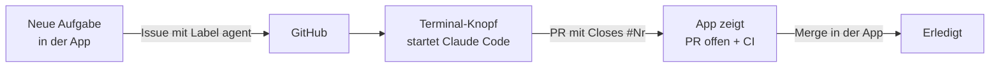

<div align="center">


# Ticky

**Tägliche Aufgaben und GitHub-Arbeit an einem Ort – direkt in deiner Menüleiste.**

[](#installation)
[](Package.swift)
[](Sources/Ticky)
[](Package.swift)
[](#dev-bereich)
[](#agent-aufgaben)
[](#daten-und-datenschutz)
[](LICENSE)


[Features](#features) · [Installation](#installation) · [Dev-Bereich](#dev-bereich) · [Agent-Aufgaben](#agent-aufgaben) · [Tastatur](#tastatur) · [Datenschutz](#daten-und-datenschutz) · [Hilfe](#häufige-probleme)

</div>

---

**Ticky** ist eine To-do-Liste, wie man sie kennt – Aufgaben, Fälligkeiten, Erinnerungen, Gruppen. Sie soll aber der **eine Ort** sein, an dem neben Alltag, Terminen und täglichen Routinen auch die **Entwicklungsarbeit** sichtbar ist: offene Pull Requests, rote CI, dringende Issues und Aufgaben, die Coding-Agents wie Claude Code selbst abarbeiten. Die Oberfläche ist an Apples **Dynamic Island** angelehnt: tiefschwarzes Panel, Pillen und Kapseln, leuchtende Akzente, federnde Animationen.

## Features

<table>
<tr>
<td width="50%" valign="top">

<h3>To-Dos, die mitdenken</h3>
Prioritäten (auch eigene, Stufe 1–5), Fälligkeiten, Gruppen mit Farbe und Notiz, Wiederholungen und Erinnerungen. Überfälliges leuchtet rot, Status-Pille oben fasst alles zusammen.
</td>
<td width="50%" valign="top">

<h3>In Sekunden erfasst</h3>
<kbd>⌃</kbd><kbd>⌥</kbd><kbd>T</kbd> öffnet das Panel von überall, <kbd>⌘</kbd><kbd>N</kbd> legt an. Priorität, Gruppe, Ablaufdatum, Extra-Erinnerung und Wiederholung in einer Ansicht.
</td>
</tr>
<tr>
<td width="50%" valign="top">

<h3>GitHub im Blick</h3>
Reviews, rote CI, eigene PRs, dringende Issues und Agent-Aufgaben – live über die GitHub CLI. Mergen mit Zwei-Klick-Bestätigung, ohne dass die App je ein Token sieht.
</td>
<td width="50%" valign="top">

<h3>Einstellbar, nicht überladen</h3>
Autostart beim Anmelden, globales Tastenkürzel, Sortierung, Gruppen, eigene Prioritäten und Farben, Erinnerungen je Priorität sowie Export und Import.
</td>
</tr>
</table>

<details>
<summary><b>Alle To-do-Funktionen</b></summary>

- **Karten:** Prioritätsfarbe als Verlauf mit leichtem Schein, darunter Pillen für Datum, Erinnerung, Wiederholung, Gruppe und „später“ (Snooze).
- **Schnell bearbeiten:** Doppelklick benennt um; das ⋯-Menü ändert Priorität und Gruppe, öffnet Fälligkeit und Wiederholung, archiviert oder löscht.
- **Gruppen:** Farbiger Pillen-Kopf mit Anzahl und mitwachsender Notizzeile. Gruppen am Griff ≡ verschieben, To-dos per Drag-and-drop hinein, zwischen und wieder heraus ziehen.
- **Sortierung:** automatisch (offen vor erledigt, dann Priorität, Fälligkeit, Erstellung) oder manuell.
- **Suche & Ansichten:** Filter-Voreinstellungen (Überfällig, Heute, Priorität, Gruppe …), Fälligkeitsansicht (Überfällig, Heute, Morgen, Diese Woche, Später), Archiv für Erledigtes.
- **Wiederholungen:** täglich, wöchentlich, monatlich oder an eigenen Wochentagen – Abhaken schiebt auf den nächsten Termin.
- **Erinnerungen:** lokale macOS-Mitteilungen mit Aktionen „Erledigen“ und „Später“ (10 Min., 1 Std., morgen 9:00). Vorlaufzeit je Priorität einstellbar. Jede Mitteilung zeigt die Uhr mit passendem Gesicht: fröhlich bei normalen Erinnerungen, gestresst mit Schweißtropfen, wenn etwas bald fällig ist, X-Augen bei Überfälligem.
- **Menüleisten-Uhr:** neutral, solange etwas offen ist – lächelt, sobald alles erledigt ist.
- **Rückgängig (⌘Z)** für Löschen, Erledigen, Verschieben, Archivieren und Gruppenänderungen.
- **Start:** optional beim Anmelden (macOS-Anmeldeobjekte, kein Hilfsprogramm); das Panel öffnet sich dort, wo du es verlassen hast.

</details>

## Installation

Voraussetzungen: **macOS 14** oder neuer und die **Command Line Tools** von Apple (fehlen sie, fragt der Installer nach – oder vorab `xcode-select --install`).

```bash
curl -fsSL https://raw.githubusercontent.com/lucasseckk/ticky/main/install.sh | zsh
```

Der Installer lädt den Code, baut Ticky auf deinem Mac (beim ersten Mal 1–2 Minuten), legt die App nach `~/Applications/Ticky.app` und startet sie. Weil sie lokal gebaut wird, blockiert macOS sie nicht als unbekannten Download. Für ein Update denselben Befehl erneut ausführen – deine Daten bleiben erhalten.

<details>
<summary><b>Oder fertige App herunterladen</b></summary>

Unter [Releases](https://github.com/lucasseckk/ticky/releases/latest) liegt `Ticky.zip` (Apple Silicon und Intel). Entpacken und `Ticky.app` nach „Programme“ ziehen. Die App ist nicht von Apple notarisiert, deshalb blockiert macOS den ersten Start: Systemeinstellungen → Datenschutz & Sicherheit → bei „Ticky“ auf **Dennoch öffnen** klicken. Alternativ im Terminal:

```bash
xattr -dr com.apple.quarantine /Applications/Ticky.app
```

Updates: neue Version herunterladen und ersetzen – deine Daten bleiben erhalten.

</details>

Ticky erscheint als Uhr in der Menüleiste und im Dock. Danach startest du sie wie jede App: <kbd>⌘</kbd><kbd>Leertaste</kbd> → „Ticky“. Beenden per Rechtsklick aufs Dock-Icon oder unten unter Einstellungen → Allgemein; dort lässt sich das Dock-Icon auch ausblenden.

<details>
<summary><b>Selbst bauen</b></summary>

```bash
git clone https://github.com/lucasseckk/ticky.git
cd ticky
zsh build.command --open   # bauen, installieren und starten
```

Mehr für Entwickler – Tests, Arbeitsweise, Agents – steht in [`CONTRIBUTING.md`](CONTRIBUTING.md).

</details>

## Dev-Bereich

Der Dev-Bereich lässt sich unter Einstellungen → Allgemein ausblenden; ohne installierte `gh` ist er von Anfang an aus. Er spricht GitHub **ausschließlich über die GitHub CLI** an. Die App speichert keine Tokens, Passwörter oder Kontodaten – die Anmeldung liegt allein bei `gh`.

```bash
brew install gh
gh auth login
```

Fehlt `gh` oder ist es nicht angemeldet, zeigt der Dev-Bereich genau diese Befehle zum Kopieren an. Welche Repositories erscheinen, wählst du direkt im Dev-Bereich: Klick auf **„N Repos ▾“** öffnet die Auswahl. Bei mehreren Repos trennt ein kleiner Trenner mit Repo-Namen PRs, Reviews und Issues.

| Bereich | Was du siehst und tun kannst |
| --- | --- |
| **Zähler-Pillen** | 👀 Review angefordert · ✕ CI rot · ↗ meine PRs – ein Klick springt zum Abschnitt |
| **Dringende Issues** | Titel mit `[P1…]`, Label `dringend`/`P1` oder dir zugewiesen; nach Rang sortiert, Repo-Filter, als Dev-To-do merken oder an einen Agent übergeben |
| **Pull Requests** | CI-Punkt (grün, rot, gelb pulsierend, grau), Autor, Alter, Draft. Mergen nur bei grüner oder fehlender CI, mit Zwei-Klick-Bestätigung |
| **Meine Dev-To-dos** | Lokale Liste nur für Entwicklung; „Als To-do“ auf einer PR-Karte legt ein Review-To-do mit Link an |
| **Aktualisierung** | beim Öffnen, alle 2 Minuten bei offenem Panel und per ↻ |

### Agent-Aufgaben

Aufgaben für Coding-Agents sind **GitHub-Issues mit dem Label `agent`** – so findet ein Agent sie selbst, ganz ohne Zugriff auf die App.



- **Anlegen:** „Neue Aufgabe“ → Repository, Titel, Aufgabe, Akzeptanzkriterien. Die App legt ein strukturiertes Issue an.
- **Claude Code starten:** Der Terminal-Knopf auf der Karte kopiert den fertigen Prompt und öffnet **Terminal mit `claude`** im lokalen Ordner des Repos. Den Ordner wählst du beim ersten Mal (änderbar über ⋯). Der Prompt wird über eine private Datei übergeben, nie als Shell-Befehl – Issue-Text kann nichts ausführen.
- **Oder selbst übergeben:** Prompt kopieren und in Claude Code oder Codex einfügen – oder der Agent sucht selbst mit `gh issue list --label agent`; das Vorgehen steht in [`AGENTS.md`](AGENTS.md).
- **Status aus GitHub:** Offen → In Arbeit (`agent:in-arbeit`) → PR offen (mit CI-Punkt) → Erledigt.

## Tastatur

| Kürzel | Aktion |
| --- | --- |
| <kbd>⌃</kbd><kbd>⌥</kbd><kbd>T</kbd> | Panel von überall öffnen (änderbar unter Einstellungen → Allgemein) |
| <kbd>⌘</kbd><kbd>N</kbd> | Neues To-do |
| <kbd>↑</kbd> <kbd>↓</kbd> | Zwischen Karten wechseln |
| <kbd>Return</kbd> | Umbenennen |
| <kbd>Leertaste</kbd> | Abhaken |
| <kbd>⌘</kbd><kbd>Z</kbd> | Rückgängig |
| <kbd>Esc</kbd> | Abbrechen |
| <kbd>⌘</kbd><kbd>/</kbd> | Alle Kürzel anzeigen (deutsche Tastatur: <kbd>⌘</kbd><kbd>⇧</kbd><kbd>7</kbd>) |

## Daten und Datenschutz

Alles bleibt auf deinem Mac:

```text
~/Library/Application Support/Ticky/
├── todos.json
├── groups.json
├── custom-priorities.json
└── Backups/
```

- **Atomar gespeichert.** Ist eine Datei beschädigt, überschreibt die App sie nicht.
- **Dateirechte:** Ordner `0700`, Dateien inklusive Backups und Exporte `0600` – andere Benutzer auf dem Mac sehen nichts.
- **Export/Import** als JSON (Einstellungen → Allgemein → Daten); vor jedem Import wird der bisherige Stand gesichert. Exporte sind Klartext – nicht in geteilte Ordner oder öffentliche Repos legen.
- **Verschlüsselung** über **FileVault**. Eine eigene Verschlüsselung mit Schlüsselbund wurde verworfen: Die ad-hoc-Signatur ändert sich bei jedem Build, der Schlüsselbund würde den Zugriff immer wieder abfragen oder verweigern.
- **GitHub:** keine Tokens in der App. In den Benutzereinstellungen liegen nur Login-Name, Repo-Auswahl, lokale Repo-Ordner und der letzte GitHub-Stand.

## Projektstruktur

| Pfad | Inhalt |
| --- | --- |
| `Sources/Ticky/App.swift` | Panel und To-Do-Liste |
| `Sources/Ticky/Settings.swift` | Einstellungen |
| `Sources/Ticky/Editor.swift` | Editor für neue und bestehende To-Dos |
| `Sources/Ticky/Store.swift` | Datenmodell, Filter, Wiederholungen, Speicherung, Rückgängig, Export/Import |
| `Sources/Ticky/Dev.swift` | Dev-Bereich: PRs, Issues, Agent-Aufgaben, Claude-Start, Dev-To-dos |
| `Sources/Ticky/GitHub.swift` | GitHub CLI, PR- und Issue-Parsing, CI-Status, Claude-Startskript |
| `Sources/Ticky/Island.swift` | Gemeinsamer Island-Look (Pillen, Karten, Schalter, Animation) |
| `Sources/Ticky/Notifications.swift` | Mitteilungen, Erinnerungen, Snooze |
| `Sources/Ticky/GlobalShortcut.swift` | Systemweites <kbd>⌃</kbd><kbd>⌥</kbd><kbd>T</kbd>, Dock-Icon |
| `Resources/Localizable.en.json` | Englische Übersetzung; Deutsch ist die Ausgangssprache, die Systemsprache entscheidet |
| `Sources/Ticky/ClockIcon.swift` | Uhr mit Gesichtern für Menüleiste, App-Icon und Mitteilungen (`Resources/AppIcon.icns`, `Scripts/`) |
| `Checks/StoreCheck.swift` | Regressionstests ohne Netzwerk |
| `build.command` / `check.command` / `install.sh` | Build, Tests und Installer |
| `AGENTS.md` | Regeln für Coding-Agents in diesem Repository |

## Häufige Probleme

| Problem | Lösung |
| --- | --- |
| Keine Erinnerungen | Systemeinstellungen → Mitteilungen → Ticky → Mitteilungen erlauben. Unter Einstellungen → Mitteilungen in Ticky testen. |
| Dev-Bereich zeigt Befehle statt PRs | `gh` fehlt oder ist nicht angemeldet: `brew install gh` und `gh auth login`, dann ↻. |
| Ein Repo fehlt im Dev-Bereich | Auf „N Repos ▾“ klicken und das Repo anhaken. |
| Terminal-Knopf startet Claude nicht | Claude Code installieren (`npm install -g @anthropic-ai/claude-code`); den Repo-Ordner über ⋯ → „Ordner ändern“ prüfen. |
| Autostart greift nicht mehr | Einstellungen → Allgemein → Start: einmal aus- und wieder einschalten. |
| ⌃⌥T reagiert nicht | Ein anderes Programm belegt das Kürzel; unter Einstellungen → Allgemein → Start ein anderes Kürzel aufnehmen. |

## Deinstallieren

```bash
pkill -x Ticky
rm -rf ~/Applications/Ticky.app                        # App
rm -rf ~/Library/Application\ Support/Ticky            # To-dos, Gruppen, Backups
defaults delete de.lucasseck.todolist                  # Einstellungen
```

Vorher Autostart unter Einstellungen → Allgemein → Start ausschalten. Wer seine To-dos behalten will, exportiert sie vorher (Einstellungen → Allgemein → Daten).

## Mitwirken & Lizenz

Beiträge sind willkommen – Ablauf und Regeln in [`CONTRIBUTING.md`](CONTRIBUTING.md), Regeln für Coding-Agents in [`AGENTS.md`](AGENTS.md).

Ticky steht unter der [MIT-Lizenz](LICENSE).
